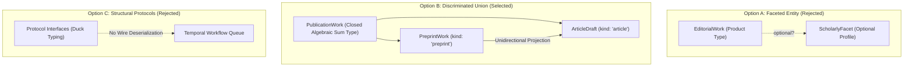

# Architectural Analysis & Decision Record: PublicationWork Discriminated Union

**Status:** Approved  
**Deciders:** Jan Ritch-Frel, Ed Phillips  
**Date:** 2026-11-04  
**Context:** `imi-pipeline` ⟷ `imi-wordpress` ⟷ `observatory-magazine-v2`  

---

## 1. Context & The Meta-Model Problem

The IMI publication ecosystem is expanding from a single-track journalistic pipeline (narrative drafts syndicated to Observatory Magazine, Salesforce, and Pardot) to a dual-track ecosystem that incorporates formal academic preprints with minted Crossref DOIs under prefix `10.67767`.

### The Symptom (Seam 1)
* In `imi-pipeline/src/phosphene/imi/draft.py`, the core model is a generic `Draft` (`title`, `body`, `author`, `category`, `source_url`, `keywords`, `metadata`).
* In `imi-wordpress/src/phosphene/imi_wordpress/domain.py`, the core model is `PreprintEntry` with 39 scholarly fields (`reg_doi`, `reg_version`, `reg_pdf_url`, `coauthors`, `license`, `abstract`, `methodology`, `doi_record`).
* In `imi-pipeline/features/steps/doi_steps.py`, integration test steps bypassed the domain models entirely, assembling raw HTTP metadata dictionaries (`_wp_create(..., {"meta": meta})`) to satisfy the WordPress REST API.

This violated the core directive of Clean Architecture:
> *"Upstream pipelines must construct pure domain POPOs; never pass raw REST dictionaries across pipeline boundaries."*

---

## 2. Comparative Analysis of Candidate Meta-Models

We evaluated three potential design approaches to raise the abstraction:



| Evaluation Dimension | Option A: Faceted Entity (`EditorialWork.scholarly?`) | Option B: Discriminated Union (`PublicationWork`) | Option C: Structural Protocols (`Protocol`) |
|---|---|---|---|
| **Invariant Rigidity** | ⚠️ **Compromised.** Treats scholarly metadata as optional personality profiles. Permitting partially formed entities forces defensive branching in every downstream consumer. | ✅ **Total.** Closed algebraic sum type. Every instantiated object satisfies all domain constraints from inception. Zero hollow fields. | ⚠️ **Untyped at runtime.** Protocols specify method shapes, not data validity or null-omission. |
| **Identity Semantics** | ❌ **Fallacy of Continuous Identity.** Presumes an editorial draft remains the "same" object when elevated to a preprint. | ✅ **Formal Promotion.** Explicit state transformation factory (`promote_to_preprint`) instantiates an immutable record with its own cryptographic/semantic identity. | ➖ Neutral. |
| **Wire Serialization & Saga Safety** | ⚠️ Complex nested optional deserialization; prone to schema drift in task queues. | ✅ **Deterministic.** Direct single-pass deserialization in Temporal workers via explicit discriminator token (`kind`). | ❌ **Fails across network seams.** Protocols lack concrete deserialization rules, requiring custom codecs. |
| **Outlet Decoupling** | ⚠️ Outlets must inspect nested facets and branch conditionally. | ✅ **Pattern Matching.** Egress outlets match on variant type and dispatch directly to specialized formatters. | ⚠️ Requires outlets to accept loose structural types. |
| **MediaWiki Integration** | ❌ Tempts engineers to pollute wiki templates with dozens of optional academic parameters. | ✅ **Unidirectional Projection.** `PreprintWork` projects an `ArticleView` (`to_article_view()`). MediaWiki remains ignorant of Crossref/DOI infrastructure. | ⚠️ Unclear projection boundary. |

---

## 3. Decision: Closed Algebraic Sum Type (`PublicationWork`)

We choose **Option B: Discriminated Union**.

### The 5 Architectural Pillars of this Decision

1. **State-Space Partitioning & Invariant Rigidity:**
   A journalistic draft and a scholarly preprint are mutually exclusive domain realities at publication time. They partition the state space cleanly. An `ArticleDraft` has zero hollow DOI fields; a `PreprintWork` cannot exist without mandatory academic provenance.
2. **Formal Promotion over Illusory Continuous Identity:**
   Journalistic drafting is mutable and broad; preprint publishing is immutable and permanent. Transitioning an editorial draft to an academic paper is an explicit promotion milestone that produces a new, version-tracked `PreprintWork`.
3. **Deterministic Saga Serialization:**
   Durable task queues in Temporal require unambiguous wire schemas. The discriminator token (`kind: Literal["article", "preprint"]`) ensures that worker deserialization directly reconstructs the concrete variant without speculative field sniffing.
4. **Unidirectional Projections over Model Compounding:**
   A scholarly paper renders on `observatory.wiki` via read-only projection (`PreprintWork.to_article_view()`). The presentation layer receives standard headline and body markup prepended with `{{Preprint}}`, shielding MediaWiki from registry mechanics.
5. **Interface Segregation at Egress Outlets:**
   Egress outlets match on variant types. `WordPressOutlet` routes `ArticleDraft` to standard content endpoints and `PreprintWork` directly to `PreprintPayloadAdapter`, ensuring changes in scholarly registry schemas never destabilize journalistic publishing pipelines.

---

## 4. Phase 1 Implementation Plan: Pure Domain Kernel

Phase 1 establishes the pure domain models, discriminator serialization, unidirectional projections, and T0 unit verification tests with zero external side effects.

### Work Breakdown & Technical Tasks

```
Phase 1: Pure Domain Kernel
├── Task 1.1: Dependency & Namespace Declaration
│   ├── Configure `imi-wordpress` in `imi-pipeline/pyproject.toml` via `[tool.uv.sources]`
│   └── Verify pure domain importability in `imi-pipeline` virtual environment
│
├── Task 1.2: Model Definition (`src/phosphene/imi/work.py`)
│   ├── Refactor `Draft` into `ArticleDraft` with `kind: Literal["article"] = "article"`
│   ├── Define `PreprintWork` with `kind: Literal["preprint"] = "preprint"` embedding pure POPOs:
│   │   Author, DOI, DOIRecord, DOIStatus, EditorialState, License, VersionInfo
│   └── Define `PublicationWork = Annotated[Union[ArticleDraft, PreprintWork], Field(discriminator="kind")]`
│
├── Task 1.3: Unidirectional Projection & Promotion Factory
│   ├── Implement `PreprintWork.to_article_view() -> ArticleDraft`
│   └── Implement `promote_to_preprint(draft: ArticleDraft, ...) -> PreprintWork`
│
├── Task 1.4: Update Event Model (`src/phosphene/imi/event.py`)
│   ├── Update `PublicationEvent` to accept `work: PublicationWork`
│   └── Provide backward-compatible `@property def draft(self) -> Draft`
│
├── Task 1.5: T0 Pure Unit Verification Suite (`tests/unit/test_publication_work.py`)
│   ├── Invariant static assertions: forbid extra fields, assert immutability
│   ├── Null-omission assertions: verify absence of hollow fields
│   ├── Wire serialization roundtrip tests: JSON dump → JSON parse → identical concrete instance
│   └── Projection and promotion factory verification
│
└── Task 1.6: CI Gate Verification
    ├── Run `uv run ruff check` and `uv run ruff format`
    ├── Run `uv run pytest tests/unit` (assert zero regressions)
    └── Run `uv run behave features/ --tags ~@integration`
```

---

## 5. Verification Gate Contracts (Phase 1)

1. **Static Type Gate:** Zero type errors across `src/phosphene/imi/` and `tests/unit/`.
2. **Wire Roundtrip Gate:** Both variants survive JSON serialization through Pydantic's discriminator adapter without losing type identity:
   $$\text{deserialized} = \text{TypeAdapter}(\text{PublicationWork}).\text{validate\_json}(\text{work}.\text{model\_dump\_json}())$$
   $$\text{type}(\text{deserialized}) == \text{type}(\text{work})$$
3. **Zero Regression Gate:** All 297 existing unit and contract tests in `imi-pipeline` must continue passing.
