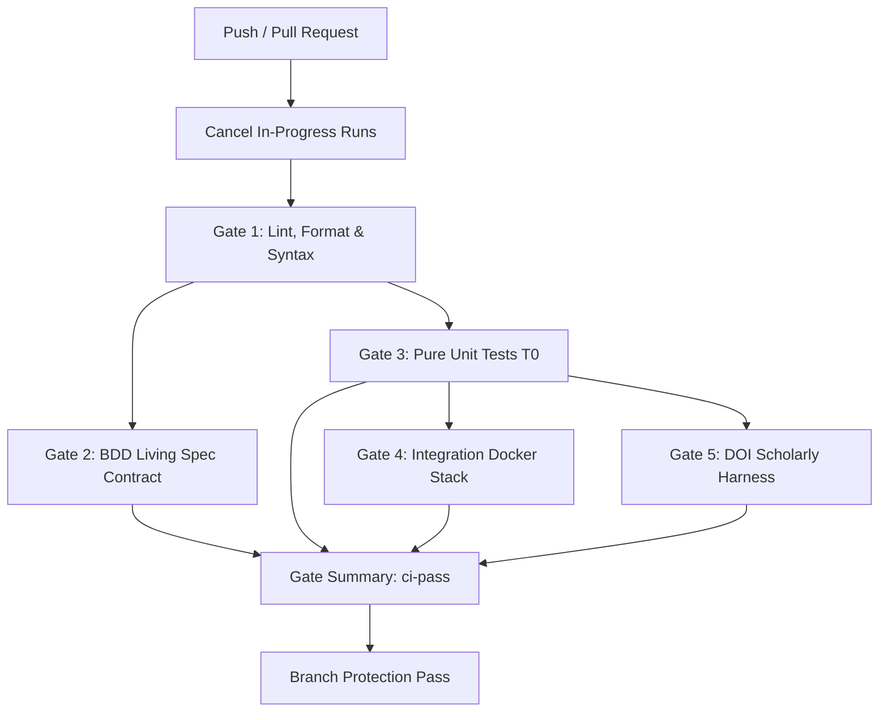

# Pull Request Discipline & Production-Grade Continuous Integration (CI)

This document formalizes the pull request (PR) governance, branch protection standards, and GitHub Actions (GHA) CI architecture across `imi-pipeline` and `imi-wordpress`.

---

## 1. Core Principles

1. **Deterministic Upstream Construction:**
   - Every invariant must be verified at the earliest possible test layer: **T0 (pure unit)** or **T1 (static contract/lint gate)** before booting containers or external networks.
2. **Outside-In Behavioral Verification:**
   - Business requirements begin with Gherkin feature files in `features/`. If a behavioral contract fails, lower-level unit tests are secondary.
3. **Linear, Traceable History:**
   - All contributions must trace directly to an OKR (`@okr_publish_pipeline`, `@okr_doi_preprint`), an Architectural Decision Record (ADR), or a documented production bug.
   - Commit history must remain linear (`rebase` or `squash & merge`).

---

## 2. Branching & Commit Conventions

### Branch Naming Convention
Branches must reflect the intent and scope of the work:
- `feat/<topic>`: New features, outlets, or capabilities.
- `fix/<topic>`: Bug fixes, parity corrections, or regression patches.
- `refactor/<topic>`: Pure architectural restructuring without observable behavior shifts.
- `docs/<topic>`: ADRs, developer guides, specifications.
- `chore/<topic>`: Tooling, dependency bumps, or CI updates.

### Conventional Commits
All commit messages must follow the Conventional Commits format:
```
<type>(<scope>): <short imperative description>

[optional body explaining rationale and invariants]

[optional footer: OKR / issue references]
```
Allowed types: `feat`, `fix`, `refactor`, `docs`, `test`, `style`, `chore`.

---

## 3. Pull Request Discipline

Every pull request must use the standard [pull request template](file:///.github/pull_request_template.md).

### The Invariant Verification Protocol
Before any PR can be approved or merged, the author and reviewer must verify:
1. **Total Invariant Validity:** Every domain entity satisfies all business constraints upon instantiation. Zero hollow or conditionally initialized fields.
2. **Discriminated Union Separation:** Journalistic editorial drafts (`ArticleDraft`) and scholarly preprints (`PreprintWork`) are strictly separated via closed sum types.
3. **Separation of Data Manipulation from Text Rendering:** Domain entities and adapters emit typed intermediate representations (`MetaTag`, dictionaries). All string formatting, wikitext rendering, and HTML escaping delegate to domain-agnostic `phosphene.utils` (Python) and `Phosphene\Utils` (PHP).
4. **Precompiled Regex Invariant:** Regular expressions are precompiled at module load time (`re.compile`). Zero inline runtime regex compilations.
5. **Scholarly DOI & SEO Safety:** Preprints with non-active DOI status never emit `<meta name="citation_doi">`. Retracted preprints emit tombstone notices without deleting scholarly records.
6. **Hermetic Docker Teardown:** Docker test stacks must be cleanly torn down on completion or failure (`make doi-down`, `down -v`).

---

## 4. Production-Grade CI Architecture (GHA)

Both `imi-pipeline` and `imi-wordpress` execute a 5-gate staged pipeline with fail-fast semantics, concurrency cancellation, and a unified summary gate (`ci-pass`).

### Gate Pipeline Overview



### Gate Definitions

| Gate | Stage | Responsibility | Execution Time |
| :--- | :--- | :--- | :--- |
| **Gate 1** | **Lint & Syntax** | `ruff check`, `ruff format --check`, and PHP syntax (`php -l`). Catches syntax and lint errors instantly. | < 15 seconds |
| **Gate 2** | **BDD Behavioral Proof** | Runs `behave features/ --tags ~@integration`. Verifies customer-visible contracts without live services. Generates living specification artifact. | < 30 seconds |
| **Gate 3** | **Pure Unit Tests (T0)** | Pytest and PHP unit suites (`php tests/php/run-pure-tests.php`). Zero network, zero database, zero disk IO. | < 10 seconds |
| **Gate 4** | **Wire-Level Integration** | Real HTTP tests against wire-level mocks for Observatory, WordPress, and Salesforce outlets (`pytest tests/integration`). | < 5 seconds |
| **Gate 5** | **DOI Test Harness** | Boots WordPress 6.4 + MariaDB 10.11 + Crossref HTTP Stub. Verifies scholarly metadata deposit, citation tags, and retraction flows. | ~ 1 minute |
| **Summary** | **ci-pass Gate** | Aggregates results of all required gates. Used as the mandatory GitHub Branch Protection status check. | Instant |

---

## 5. In-Repo Workspace Vendoring (`lib/imi_wordpress`)

To guarantee hermetic, credential-free execution in public CI (`FlowFeel/imi-pipeline`), scholarly domain POPOs, adapters, and utils are maintained as an in-repo workspace package in `lib/imi_wordpress`.

- Configured via `[tool.uv.workspace] members = ["lib/temporal", "lib/imi_wordpress"]`.
- Eliminates cross-repo token requirements and network dependencies during runner bootstrap.
- Ensures identical execution locally and on GitHub Actions runners.
